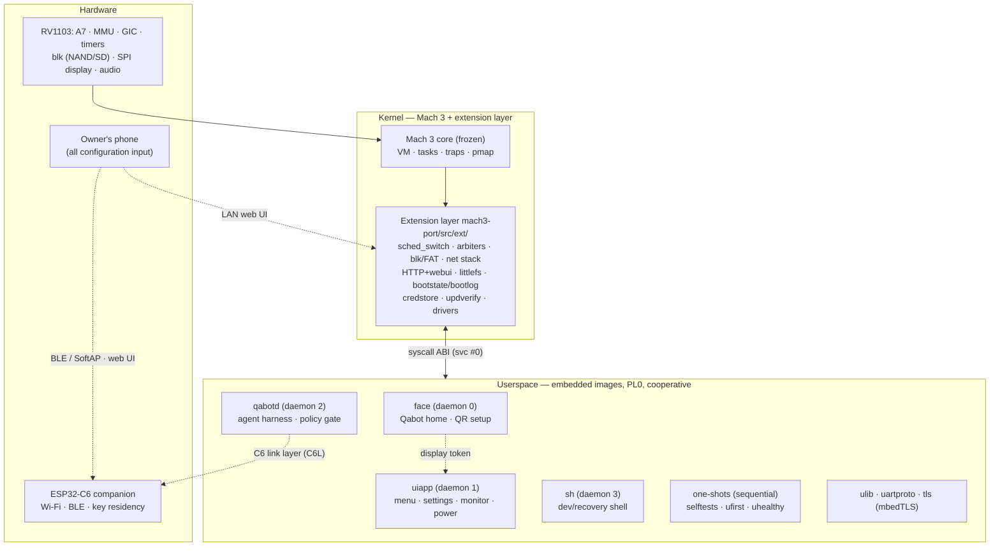
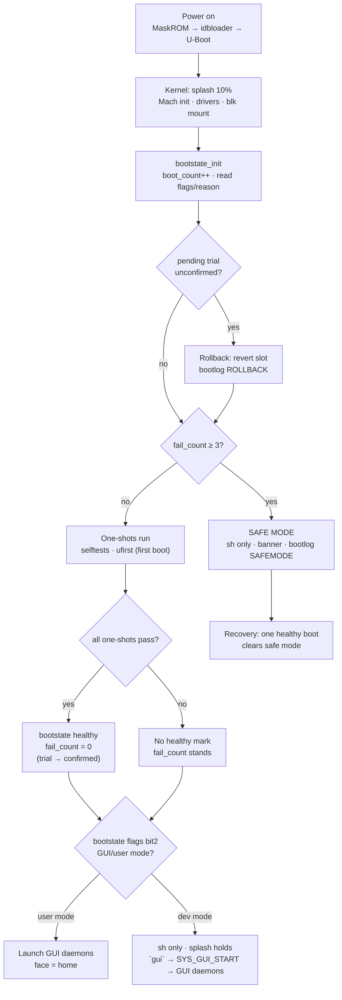
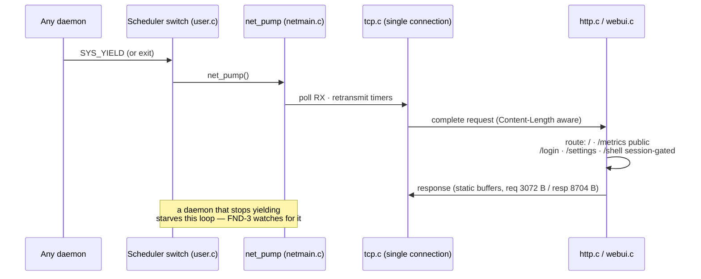
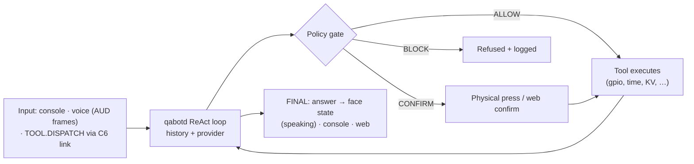
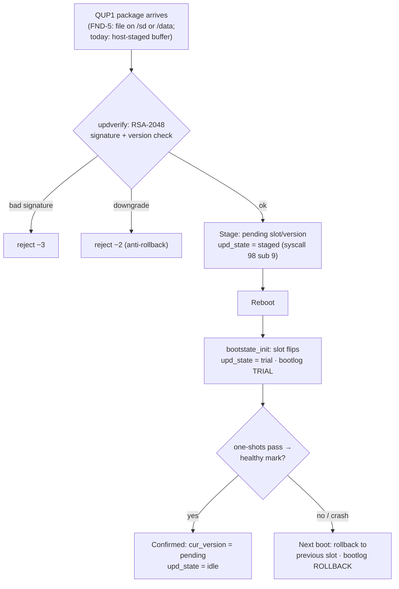
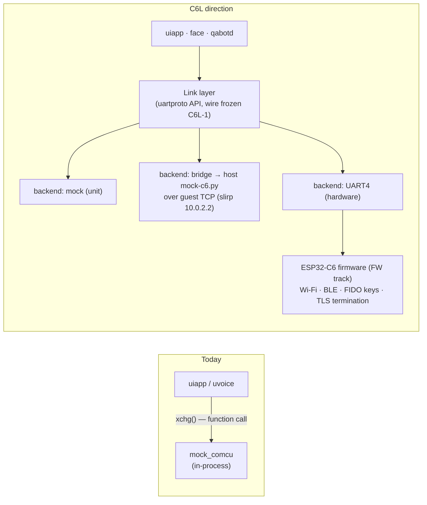
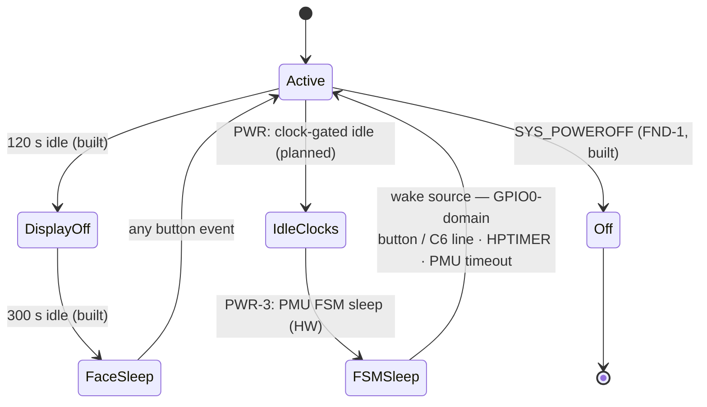

# QaonicOS — Master Architecture

Date: 2026-10-23. Status: standing reference. This document
describes the architecture of the system **as built**,
the flows that define it, and the direction it converges
to. It is the document new phases cite for "how does this
fit the architecture".

## How to read this document (and its companions)

| Document | Answers |
|---|---|
| **This document** (`ARSITEKTUR-SISTEM.md`) | What are the parts, how do the flows run, where is it going? |
| `SYSCALL-ABI.md` | The exact kernel↔userspace interface (numbers, arguments, semantics) |
| `ARSITEKTUR.md` | The placement rules: what may live in kernel vs userspace, and the kernel admission rule |
| `riset-arsitektur-os/RINGKASAN.md` | The research behind §2–§3: pattern comparison, the verdict, the open questions |
| `riset-soc-rv1103/RINGKASAN.md` | What the RV1103 silicon offers and what QaonicOS uses of it |
| Track plans (`rencana-*/PLAN.md`) | What each track builds, phase by phase |

Rule of precedence: code beats this document. Where they
disagree, the code is the truth and this document is owed
an update in the same commit that changes the shape.

## 1. What QaonicOS is

A single-purpose appliance OS for the Luckfox Pico Mini B
(Rockchip RV1103: single-core Cortex-A7, 64 MB DDR2,
128 MB SPI NAND), pairing the board with an ESP32-C6
companion MCU that owns Wi-Fi/BLE and key residency on
hardware. It boots to a procedural agent face (Qabot),
offers settings/monitor/power UI on physical buttons,
serves a PIN-gated web UI, runs an on-device agent harness
with cloud LLM modes, and updates itself with signed A/B
packages that can never brick it. The full verdict on its
architecture — and the pattern comparison behind it — is
in `riset-arsitektur-os/RINGKASAN.md` §2; in short:
**hybrid in structure (Mach substrate + in-kernel
extension layer), RTOS-shaped in composition (a fixed,
statically embedded program set), appliance-shaped in
its non-negotiables.**

## 2. Design principles

Binding. Each cites the decision or research it comes
from; a phase that needs an exception argues it in its
plan, in writing.

| # | Principle | Source |
|---|---|---|
| P1 | The kernel is the real Mach 3; the core is frozen — product logic enters via the extension layer or userspace | owner 2026-09-28; FND plan |
| P2 | The syscall ABI is the only kernel↔user contract; documented, grown by append | SYSCALL-ABI.md; foundation audit #14 |
| P3 | Cooperative scheduling; preemption only when a measurement gates it in | threading research |
| P4 | Kernel owns arbitration + safety invariants; policy + presentation live in userspace | ARSITEKTUR.md |
| P5 | One owner per shared resource (display, console, TCP connection, link transport, secrets) | as-built; C6 plan D-C6L-4 |
| P6 | Every subsystem is QEMU-verifiable; hardware-only behaviour hides behind a TODO(HW) seam with a simulated source | standing workflow; PWR-1 pattern |
| P7 | Resilience is architecture: no boot path bricks, no update strands, no daemon death wedges, no plaintext secrets | B2/B4/B5 tracks; FND track |
| P8 | On hardware the C6 is the network boundary; the guest stack is a development surface | F5 research; UTANG-TEKNIS §1 |
| P9 | The device explains itself: first boot offline tells the user what to do; safe mode is a recovery surface, not a dead end | out-of-box research |
| P10 | Userspace stays a fixed, statically composed set until a product need — not a Unix reflex — argues otherwise | RTOS-habits verdict, research §1.4 |

## 3. Layered architecture



### 3.1 Component map

Status: **built** (runs in QEMU today) · **draft**
(written, hardware-gated) · **planned** (in a track plan)
· **parked** (deliberately deferred by the owner).

| Component | Where | Status | Notes |
|---|---|---|---|
| Mach 3 core (VM/task/trap/pmap) | kernel core | built | ported MD layer; core semantics untouched (P1) |
| Extension layer: scheduler switch + daemon registry | `user.c` | built | daemons 0–3; one-shots sequential; SYS_GUI_START (102) defers GUI in dev mode |
| Resource reclamation on daemon death | `user.c` exit/fault paths | built (FND-2) | display token, console owner, face state released |
| Display arbiter + event queue | `user.c`, syscalls 60–68 | built | one token; face default holder; injection (105) for QEMU/tests |
| Console arbiter | `user.c` | built | SYS_CONSOLE_TAKEOVER; sh owns in dev mode |
| Block layer + FAT32 (`/sd`) | `blk.c`, `fat32.c` | built | QEMU virtio-blk; NAND/SFC driver is the hardware step |
| littlefs (`/data`) | `lfs_port.c` + vendored lfs | built | Persistent blk backend in QEMU since FND-4 (tail region); NAND region = blocks 320–999 on HW |
| Mach IPC (registry + RPC) | `ipc_glue.c`, syscalls 10/11/12/23/25 | built (IPC-1..5) | Inline cap 4096 B, default qlimit 5, max 16; registry 8 entries + generations; reserved names `tools` (qabotd), `link` (C6L-5); `uipc.h` v1 frozen; blocking recv = third switch point |
| Network stack (ARP/IP/UDP/TCP) | `netstack.c`, `tcp.c` | built | single-connection TCP; pumped from scheduler switch points |
| HTTP server + web UI + dashboard | `http.c`, `webui.c` | built | `/` + `/metrics` public; settings + web shell PIN/session-gated (103) |
| Boot resilience | `bootstate.c` | built | state sector + 16-record bootlog ring; fail_count ≥ 3 → safe mode |
| Update manager (A/B, trial, rollback) | bootstate subs 7/9/11 | built | QUP1 signed packages (RSA-2048/SHA-256); FND-5 adds file delivery |
| Credential store | `credstore.c`, `aesgcm.c` | built | AES-256-GCM QSEC files; device key is a build-time placeholder — OTP wrapping is the HW step (documented as obfuscation-grade until then) |
| Reset / poweroff | `psci.c`, syscalls 106/107 | built (FND-1) | PSCI HVC in QEMU; RV1103 PMU/WDT mapping is TODO(HW) |
| Audio (ACODEC + I2S0 RX + voice frames) | `audio.c`, syscalls 82–88 | built | D1–D4 verified in QEMU |
| PL330 DMA | `pl330.c`, syscalls 89–92 | built (stage 1) | structure verified; real transfers are HW |
| Kernel splash | `gpu.c` | built | procedural logo + progress; virtio-gpu in QEMU, SPI/ST7789 on HW (draft drivers in `draft/`) |
| face | `user/face` | built | procedural renderer + QR encoder (byte mode, ECC M, V1–6) |
| uiapp | `user/uiapp` | built | hand-rolled screens today; **LVGL adopted inside uiapp only** (UI track, gated on UI-1 size measurement) |
| qabotd + harness | `user/qabotd.c`, `user/qabot` | built | ReAct loop + policy gate (ALLOW/CONFIRM/BLOCK); providers per §5.3 |
| sh | `user/sh.c` | built | dev surface + recovery surface (safe mode) |
| One-shots | `user/u*.c` | built | selftests double as the regression battery |
| uartproto (C6 protocol v1 + mock) | `user/uartproto` | built | in-process mock today; becomes the link layer in C6L |
| linkd (single link owner) | — | planned | C6L-5 |
| Power policy (SYS_POWER 108, ladder, simulated source) | — | planned | PWR-1, board-less half designed |
| TRNG entropy service (`SYS_RANDOM`) | — | planned | SOC-2; retires the xorshift TLS entropy (audit #13) |
| FPU/NEON user context | `fpu.c` (stubs today) | planned | THR-1 — save/restore are empty stubs; enabling codegen before THR-1 corrupts FP state across switches |
| ntp daemon | `user/ntp.c` | parked | commented out of the daemon set (UDP sandbox); time-sync gating (100/101) is built around it |
| C6 firmware (FW-1..3) | ESP32-C6 | parked | owner-deferred; the link track (C6L) is host-side only until then |
| Secure boot (OTP) | — | parked | owner-deferred 2026-10-21 (B5.4) |

## 4. Boot flow

Two modes, one mechanism: the bootstate flags bit2 selects
GUI/user mode; dev mode registers only `sh` and the GUI set
launches on demand via SYS_GUI_START (102). The splash is
drawn by the kernel (`gpu.c`) before any daemon runs, so
the screen is never black during boot.



Facts that matter: the healthy mark is *earned* by the
one-shot battery passing, not by reaching a prompt; a
trial boot that never earns it rolls back at the *next*
bootstate_init; power cuts are survivable because the
state sector and bootlog live at the device tail, outside
any filesystem.

## 5. Runtime flows

### 5.1 Display / GUI arbitration

One display, one token, two rendering daemons. The kernel
is the arbiter; the face is the default holder and the
home screen; input events go only to the holder, and the
queue is flushed on every transfer so no stale event
crosses a handover.

```mermaid
sequenceDiagram
    participant U as User (buttons)
    participant K as Kernel (arbiter + EV queue)
    participant F as face (holder)
    participant A as uiapp
    U->>K: EV_MENU (button / syscall 105 inject)
    K->>F: event via SYS_DISPLAY_GET_EVENT (65)
    F->>K: SYS_DISPLAY_GRANT (62)
    K->>A: token = uiapp; EV queue flushed
    A->>K: SYS_DISPLAY_FLUSH (61) strips
    U->>K: EV_BACK at menu root (or 30 s idle)
    A->>K: SYS_DISPLAY_RELEASE (64)
    K->>F: token = face; face resumes rendering
    Note over K,F: holder death → FND-2 reclaim returns<br/>the token automatically; face re-renders
```

The Power screen's Shutdown/Restart are real (FND-1:
syscalls 106/107, reason recorded before the platform
acts); Sleep Now releases the token and returns to the
face's display-off path. Display sleep today is a
*display* state (panel black, SoC fully clocked) — the
real power ladder is §5.7.

### 5.2 Network pump, TCP/HTTP and the web UI

There is no network thread. The scheduler's two switch
points (SYS_YIELD handling and the exit switch in
`user.c`) call `net_pump()`; each call runs one server
iteration (RX, TCP timers, one HTTP request). Everything
web-shaped therefore executes in kernel context — the
placement debt recorded in the research (§3.1 there) and
in ARSITEKTUR.md.



Session model: one admin session (cookie `qaon_sess`),
PIN = SHA-256 over a domain-separated string, stored via
the credential store. The web shell is a *bridge* to the
console (states 0–3 via syscall 103), off by default,
auto-off after 15 min idle (D-ONB-5).

### 5.3 Agent runtime — qabotd and modes A/B/C

qabotd hosts the harness: a ReAct loop (MAX_STEPS 8,
30 s budget) over a provider interface, with every tool
call passing a pre-execution policy gate
(ALLOW / CONFIRM — physical or web confirmation /
BLOCK). The gate is the safety boundary; the link layer
(C6L) dispatches tools **only** through it, never around
it.



The three connectivity modes are provider/topology
choices behind the same loop:

| Mode | Shape | Status |
|---|---|---|
| **A — direct** | Device calls an LLM API itself (OpenAI-compatible; TLS 1.2 via mbedTLS in userspace) | built for dev/QEMU; live use parked (owner skipped the API key) |
| **B — companion** | Device is the server (MCP-style); a cloud-side harness (Jivix; Muse Gadget is the reference design) is the client; private keys reside on the C6 | design; lands with C6L-3 + FW track |
| **C — hybrid** | A and B combined per task/policy | design |

Mode A on hardware is expected to move behind C6 TLS
termination (P8); the guest TLS stack remains the dev
path (its keep-alive limits under QEMU slirp are
documented in UTANG-TEKNIS §1 — an environment limit, not
a stack bug).

### 5.4 Update: stage → trial → confirm or rollback



The package cap in QEMU is 8 KB; the delivery path
(FND-5's `update stagepkg <path>`) reads a real file in
chunks into the same verified staging path — the verify
step is not bypassable by any delivery route (P7).

### 5.5 Onboarding / provisioning

Decisions D-ONB-1..7 (owner, 2026-10-21) govern this
flow: one QR bootstraps two transports; the PIN is the
single gate; the API key is optional and its absence
means fully offline, by design.

```mermaid
sequenceDiagram
    participant F as face
    participant P as Phone
    participant K as Kernel (webui/credstore/bootstate)
    F->>F: unprovisioned → QR screen<br/>"QAON1:" + device secret + ":QaonicOS-Setup"
    P->>F: scan QR
    alt Android app path
        P->>P: BLE to C6 → provisioning (ONB-3, with C6L/FW)
    else Browser path
        P->>K: join C6 SoftAP → captive portal (ONB-4, with C6)
    end
    P->>K: set device PIN (mandatory) · name · timezone
    K->>K: PIN → SHA-256 → credstore (QSEC, encrypted)
    P->>K: Wi-Fi credentials via link layer (C6L)
    K->>K: bootstate provisioned flag (bit0)
    F->>F: finale → face home; hint "PRESS BUTTON FOR MENU"
    opt API key (skippable, D-ONB-2)
        P->>K: key → credstore; empty = Qabot fully offline
    end
```

Built today: the PIN gate, settings page, web shell and
the QR encoder (ONB-1/ONB-2, verified by decode). Waiting
on the C6 track: the BLE and SoftAP transports (ONB-3/4)
and separating the QR's device identity from its secret
(ONB-5 item in the onboarding plan).

### 5.6 The C6 link

Today the "link" is a function call: uiapp's uartproto
client calls an in-process mock co-MCU that answers from
the RV1103's own SD card. C6L turns that seam into the
architecture: one link layer, three backends, one owner.



Wire: v1 text lines (WIFI.* / BLE.* / NET.HTTP / TIME.GET
/ KV.* / FIDO.*) + v2 binary frames (AUD today;
TOOL.DISPATCH / EVT / NET.WS framing is C6L-3). Two known
drifts between the frozen spec and the code (KV value
framing, BLE.STATUS payload) are C6L-1's to resolve.
Because the guest TCP stack is single-connection, the
bridge backend and qabotd's Mode-A provider can never
hold it at once — linkd (C6L-5) becomes the single
transport owner (P5). FIDO private keys never cross the
UART, in either direction, ever.

### 5.7 Power states

Today's "sleep" is a display state, not a power state:
after 120 s idle the panel goes black; after 300 s the
face stops rendering; the SoC never leaves full clock
and no code touches the PMU. The ladder below is the
PWR track's design (research: riset-power-battery),
shaped so policy lives in userspace over one syscall
(SYS_POWER, 108 — proposed) and the sensing source can
be swapped (SARADC IN1 voltage model now, a gauge IC
later) without an ABI change.



Battery: there is no battery field in `qaon_stat` and
the datasheet publishes no SoC current figures — every
budget number until the board is measured is an estimate,
and the research says so. Wake-line placement is the
load-bearing hardware fact: only VD_PMU-domain sources
(GPIO0 interrupt among them) wake the deep states, so
the button and the C6 wake line must land there.

### 5.8 Storage

Two filesystems, two jobs. littlefs on `/data` is the
device's own state (config `cfg-*`, credentials as QSEC
files, the provisioning secret); FAT32 on `/sd` is
exchange media (update packages, user files). Boot
resilience state is on **neither** — it sits in raw
sectors at the device tail, so a filesystem failure can
never take the recovery story with it.

| Layer | Today (QEMU) | On hardware |
|---|---|---|
| littlefs backend | RAM, 1 MB, power-cut simulator for tests | SPI NAND via SFC draft driver, blocks 320–999 (FND-4 adds the persistent QEMU backend mirroring this layout) |
| `/sd` | virtio-blk image, FAT32 | the Mini B's TF socket on SDMMC (SoC synthesis, correction §6) |
| Boot state + bootlog | last sectors of the blk device | same logical position on NAND |
| Update staging | kernel package buffer (8 KB cap) | A/B slots per B4 state machine |

littlefs-on-NAND semantics (erase → 0xFF, block wear) are
preserved by the port in both backends; the RAM backend's
volatility in QEMU is a known, documented delta, and it
is why FND-4 exists.

## 6. Cross-cutting concerns

### 6.1 Resilience

Three independent layers, each assuming the one below it
can fail:

1. **Daemon layer** — a faulting daemon dies alone (PL0
   isolation); FND-2 reclaims what it held (display
   token, console, face state); FND-3's supervisor
   watches heartbeats and escalates: log → kill + reclaim
   → respawn where possible → crash mark (reason 3) +
   reset → the boot layer's 3-strikes rule.
2. **Boot layer** — bootstate counts failures across
   power cycles; fail_count ≥ 3 → safe mode (shell only);
   one healthy boot clears it. The hardware watchdog
   (NS dw-wdt @ `0xff5a0000`, two-stage) joins this layer
   on hardware: it covers the case the software
   supervisor cannot — the kernel itself wedged.
3. **Update layer** — §5.4: an unconfirmed trial reverts
   itself; anti-rollback (−2) stops version attacks;
   signatures are verified before staging, always.

Acceptance bar (out-of-box research): 100/100 unattended
cold boots (soak-verified 2026-10-20), 100 random power
cuts with the FS intact, failed update → previous version
boots, 3 crashes → recovery, never a brick.

### 6.2 Security

| Mechanism | State |
|---|---|
| Credential store: AES-256-GCM (QSEC), per-secret files, legacy plaintext auto-migrates | built (B5.5) |
| Device key: build-time placeholder today → **obfuscation-grade only**; OTP-wrapped random key is the hardware step | seam built, HW pending |
| PIN: SHA-256 (domain-separated), constant-time compare, throttle with exponential lockout (5 fails → 30 s … 900 s cap) | built (ONB-1 + B5.5) |
| Signed updates: RSA-2048 PKCS#1 v1.5 + SHA-256, anti-rollback | built (B5.3/B4) |
| Policy gate on agent tools: CONFIRM for physical-world actions, BLOCK for destructive ones | built (Q3) |
| Key residency: FIDO/LLM keys terminate at the C6 on hardware; private keys never cross the UART | design (C6L/FW) |
| Entropy: timer + xorshift today — **weak, documented**; TRNG service is SOC-2 | debt (audit #13) |
| Secure boot | **parked by owner** (B5.4, 2026-10-21) |

The honest summary: the *shapes* are all in place; the
two items whose strength is currently borrowed (device
key, entropy) are exactly the two with named hardware
successors.

### 6.3 Time

Two clocks, deliberately separate: the **wall clock**
(SYS_TIME_SET/GET, 69/70) and **sync quality** (syscalls
100/101 — only the NTP path may mark time *synced*, as
opposed to merely *set*). Consumers that care (TLS
validation, schedules) gate on quality, not on the mere
presence of a value. The kernel derives wall time from
the 100 Hz tick; uptime (67) is monotonic and is what
pacing code uses. The ntp daemon itself is currently out
of the daemon set (sandbox UDP), so in QEMU time is set
by test one-shots — a documented delta, not a design
change.

### 6.4 Observability

- **bootlog**: 16-record persistent ring (events 1–12,
  incl. TRIAL/ROLLBACK/SAFEMODE/software-reset), readable
  via `bootlog` in sh and syscall 99.
- **SYS_STAT (57)**: uptime, memory, block, net counters
  into `qaon_stat`; two fields are honestly UNKNOWN today
  (cpu_pct — no idle accounting; blk_used_sec) rather
  than fabricated.
- **Web dashboard + /metrics**: the same numbers over
  HTTP (§5.2).
- **Selftests as telemetry**: the one-shot battery's
  PASS/FAIL lines are both the regression suite and the
  healthy-mark input — the device reports its own health
  in the same vocabulary the developers test with.

## 7. Hardware reality (RV1103) and QEMU deltas

From the SoC synthesis (`riset-soc-rv1103/RINGKASAN.md`,
56 blocks inventoried):

**The silicon gives** — and QaonicOS mostly hasn't taken
yet: a hardware TRNG (`0xff448000`), a crypto engine v3
(AES-GCM/XTS, SHA-256, 4096-bit PKA — a point-for-point
map onto today's software crypto), a two-stage hardware
watchdog, RGA2 2D acceleration, a camera pipeline
(CSI-2 + ISP; the Mini B *does* route a CAM FFC
connector), SDMMC with a populated TF socket, DWC3 USB
2.0 (device-first on the board's USB-C), a GMAC+PHY whose
pairs reach castellated holes (no magnetics — a bench
path, not a product port), SARADC IN1 free for battery
sensing, and two RISC-V MCUs (HPMCU — possibly already
running vendor test-board firmware in our boot chain,
ground truth pending; LPMCU — the PMU sleep sequencer
question inside PWR-3).

**The silicon takes away**: there is **no VOP and no
video decoder** — SPI → ST7789 is the only display path,
permanently, and hardware video playback will never
exist. Analogue audio nets are not broken out (H4 must
resolve how mic/speaker attach; AUD_DSM sits on H2
GP10/GP11). The A7 runs at 1.104 GHz per the vendor DTS —
the "1.2 GHz" in older strings is marketing, corrected
in the synthesis register.

**QEMU-vs-hardware deltas** (the standing list every
flow above silently assumes):

| Area | QEMU | Hardware |
|---|---|---|
| Display | virtio-gpu framebuffer | SPI0 → ST7789 (draft driver; pacing unverifiable in QEMU) |
| Block device | virtio-blk image | SPI NAND via SFC (draft) + SDMMC |
| Network | slirp 10.0.2.2, single TCP, kernel stack | C6 over UART4; guest stack is dev-only |
| Reset/poweroff | PSCI HVC | PMU/WDT seam in `psci.c` |
| Input | serial → EV queue (+ syscall 105 injection) | GPIO buttons → same EV queue |
| GPIO/timers | QEMU addresses | RV1103 addresses (GIC binding is QEMU-shaped today — SOC-1) |
| Entropy/crypto/accel | software | TRNG / crypto v3 / RGA2 (SOC track) |
| Time sync | test-set | NTP via C6 |

## 8. Evolution direction

**Committed order** (owner, 2026-10-23; IPC inserted
2026-10-24 by owner decision D-ARCH-4): FND-1..5 →
IPC-1..5 → C6L-1..5 → UI-1..6. **Proposed,
unscheduled**: SOC-1..6, PWR-1..4, THR-1..5. What each
changes *architecturally*:

| Track | Architectural delta |
|---|---|
| FND | Completes the resilience story at daemon granularity (reclaim, supervision) and gives updates a real delivery path; littlefs becomes persistent in QEMU, closing the biggest test/reality gap |
| IPC | Adds the second, sanctioned mechanism: real Mach message passing (syscalls 10/11/12/23/25, kernel registry + RPC, `uipc.h` v1 frozen) beside the per-service syscall surfaces; blocking `SYS_RECV` becomes the scheduler's third switch point (D-IPC-1); the first daemon-to-daemon hand-offs (registry names `tools`, `link`) |
| C6L | Turns a function call into a link layer with one owner (linkd); freezes the wire; consumes IPC directly (linkd is an IPC server from its first commit; TOOL.DISPATCH becomes an IPC RPC to `tools`) — Q-A3 is answered, not pending |
| UI | LVGL inside uiapp only; the face stays hand-rolled. UI-1's size measurement feeds Q-A2 (image delivery) |
| SOC | Platform plumbing first (CRU/pinmux/GIC tables), then entropy + crypto services, storage/USB, RGA2, and — only by explicit owner go — the camera pipeline |
| PWR | Adds the power ladder and the SYS_POWER surface; policy in userspace, sensing behind a swappable source |
| THR | THR-1 makes FP state real in the context switch (the precondition for any NEON code); preemption (THR-3) stays gated on LVGL-era jitter measurement |

**Invariants that must hold through all of it** (the
convergence commitments of the research, §2.1): the Mach
core stays frozen; the ABI only grows; one owner per
resource; resilience mechanisms are inherited, not
re-argued; hardware-only code keeps a simulated seam;
and any change that would break the out-of-box acceptance
bar (§6.1) is an architecture change, reviewed as one —
not a feature detail.

## 9. Open architecture questions

Numbered Q-A1..Q-A7 in `riset-arsitektur-os/RINGKASAN.md`
§4: the kernel HTTP server's fate; daemon image delivery;
whether Mach IPC is ever switched on; a general process
model; who owns the network pump; the device's Mode-B
serving surface; one written secrets rule across
credstore and C6. They are the owner's to answer; tracks
that reach one must stop and surface it rather than
decide it silently.

**Update 2026-10-24:** the owner has answered. The HTTP
server moves to a userspace httpd after C6L, the netstack
splits at the transport, R14 stands as guidance (see
`docs/ARSITEKTUR.md`, "Resolutions — owner decisions,
2026-10-24"), and Q-A3 is settled the other way than
this document assumed: **Mach IPC will be built**, as
its own track between FND and C6L, with linkd +
TOOL.DISPATCH as first consumers. The §1 statement
that IPC is not the system's service mechanism is
superseded for that track; per-service syscall surfaces
remain the mechanism everywhere else.

**Close-out 2026-10-24 (IPC-5):** the IPC track is
DONE (IPC-1..IPC-5, see `docs/rencana-ipc/DEVLOG-IPC5.md`).
What Q-A3's answer became in code: real Mach message
passing via `mach3-port/src/ext/ipc_glue.c`, syscalls
10/11/12/23/25, an 8-entry kernel registry with
generations and reserved names (`tools` served by
qabotd, `link` reserved for linkd), RPC over send-once
reply ports, inline cap 4096 B, default qlimit 5
(max 16), and blocking `SYS_RECV` as the scheduler's
third switch point. The v1 contract is frozen in
`user/ulib/uipc.h`; C6L builds against it. The
remaining open questions are Q-A1 (answered: httpd
after C6L), Q-A2, Q-A4, Q-A5, Q-A6, Q-A7.
