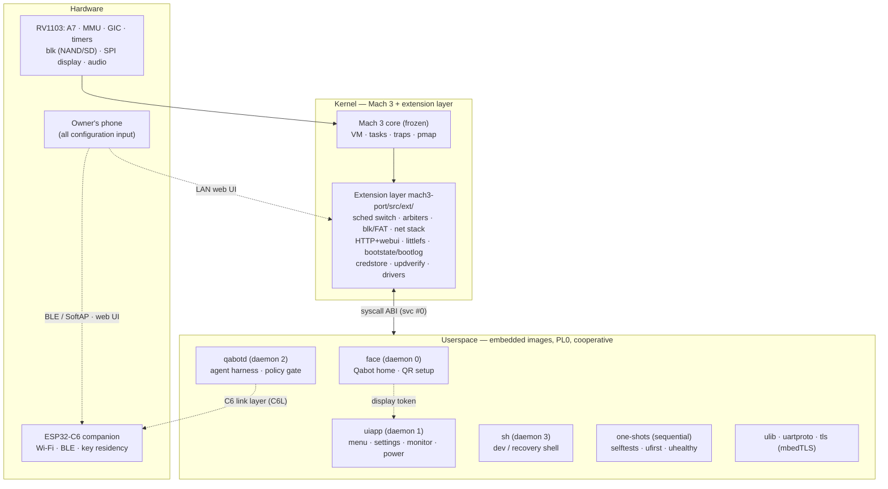
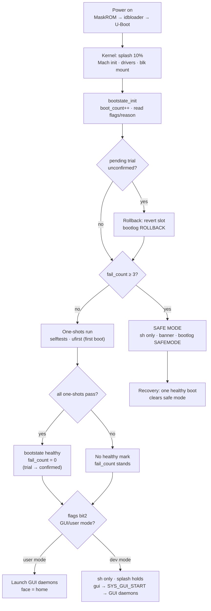

# Architecture

QaonicOS is a Mach 3 kernel plus a hand-written extension layer,
running a fixed set of cooperative userspace programs. This page is
the structural summary; the canonical text is
[`docs/ARSITEKTUR-SISTEM.md`](../docs/ARSITEKTUR-SISTEM.md), and the
placement rules live in
[Kernel / Userspace Boundary](kernel-userspace-boundary.md).

> **Key facts**
>
> - **Only crossing:** the syscall ABI (`svc #0`); no shared-memory ABI, no Mach IPC in the product path.
> - **Scheduling:** cooperative — daemons switch only at `SYS_YIELD` and at exit; the network stack is pumped from those same two switch points.
> - **Program set:** daemons `face` (0), `uiapp` (1), `qabotd` (2), `sh` (3), plus sequential boot one-shots; all embedded in the kernel image.
> - **Boot partition headroom:** ~287 KB over the measured image — size is an architectural constraint, not an afterthought.
> - **Modes:** user mode boots straight to the GUI; dev mode boots to the shell and starts the GUI on demand (syscall 102).

## Layers

What Mach actually provides today is **memory isolation**: each
program gets a real Mach task and runs at PL0; a fault kills that
one task. The `thread_t` objects are created but never scheduled,
and the IPC syscall numbers (10–12, 23) have sat reserved and
unused since Fase B — services are reached through syscalls over
shared kernel state, not through ports. Naming this honestly
matters: it is why the boundary rules
([R1–R14](kernel-userspace-boundary.md)) exist.

## Component map (digest)

| Component | Where | Status |
|---|---|---|
| Mach 3 core (VM/task/trap/pmap) | kernel core | built |
| Scheduler switch + daemon registry | `user.c` | built |
| Resource reclamation on daemon death (FND-2) | `user.c` exit/fault paths | built |
| Display arbiter + event queue | `user.c`, syscalls 60–68 | built |
| Console arbiter | `user.c` | built |
| Block layer + FAT32 (`/sd`) | `blk.c`, `fat32.c` | built |
| littlefs (`/data`) | `lfs_port.c` + vendored lfs | built (RAM backend in QEMU; FND-4 persists it) |
| Network stack (ARP/IP/UDP/TCP) | `netstack.c`, `tcp.c` | built (single TCP connection) |
| HTTP server + web UI | `http.c`, `webui.c` | built (in kernel — a recorded placement debt) |
| Boot resilience | `bootstate.c` | built |
| Update manager (A/B, trial, rollback) | bootstate subs | built |
| Credential store | `credstore.c`, `aesgcm.c` | built |
| Reset / poweroff (FND-1) | `psci.c`, syscalls 106/107 | built |
| Audio (ACODEC + I2S0 RX + voice frames) | `audio.c`, syscalls 82–88 | built |
| PL330 DMA (stage 1) | `pl330.c`, syscalls 89–92 | built |
| face / uiapp / qabotd / sh | `user/` | built |
| uartproto (C6 protocol + in-process mock) | `user/uartproto` | built |
| linkd (single link owner) | — | planned (C6L-5) |
| Power policy (SYS_POWER 108) | — | planned (PWR-1) |
| TRNG entropy service (SYS_RANDOM) | — | planned (SOC-2) |
| FPU/NEON user context | `fpu.c` (stubs today) | planned (THR-1) |
| ntp daemon | `user/ntp.c` | parked (disabled in the daemon table) |
| C6 firmware (FW-1..3), secure boot | — | parked by owner decision |

## Boot flow (both modes, one mechanism)

The bootstate flags bit2 selects GUI/user mode. The kernel draws
the splash (procedural logo + progress) before any daemon runs, so
the screen is never black. Dev mode registers only `sh`; the GUI
set launches via `SYS_GUI_START` (102) — the shell's `gui` command.

Two facts carry the design: the **healthy mark is earned** by the
one-shot battery passing (not by reaching a prompt), and
resilience state lives in raw sectors at the device tail —
outside any filesystem (see [Boot & Resilience](boot-resilience.md)).

## The eight runtime flows (summaries)

1. **Display / GUI arbitration** — one display, one kernel-held
   token; the face is the default holder and home screen; events go
   only to the holder and the queue is flushed on every transfer.
   Details: [Display, UI & Face](display-ui-face.md).
2. **Network pump + web UI** — no network thread: `net_pump()` runs
   one server iteration from the scheduler's two switch points, so
   HTTP handlers execute in kernel context today (the flagship
   placement debt, [boundary page](kernel-userspace-boundary.md)).
3. **Agent runtime** — qabotd's ReAct loop passes every tool call
   through a policy gate (ALLOW / CONFIRM / BLOCK); modes A/B/C are
   provider topologies behind the same loop.
   Details: [Qabot Agent Runtime](qabot-agent.md).
4. **Update** — stage → trial boot → healthy-mark confirm, or
   automatic rollback; signature verification is inseparable from
   staging. Details: [Updates](updates.md).
5. **Onboarding** — one QR bootstraps phone setup; the device PIN
   is the single gate for web settings, web shell and sensitive
   confirmations. Details: [Onboarding & Security](onboarding-security.md).
6. **C6 link** — today a function call into an in-process mock;
   C6L turns the seam into a link layer with three backends and one
   owner (linkd). Details: [Networking & the C6 Link](networking-c6.md).
7. **Power** — today's "sleep" is a display state only; the PMU
   ladder, wake sources and battery policy are the PWR track.
   Details: [Power & Battery](power-battery.md).
8. **Storage** — littlefs for device state, FAT32 for exchange
   media, raw tail sectors for boot resilience.
   Details: [Storage](storage.md).

## Design principles (digest)

The binding set (P1–P10 in the source): the Mach core is frozen;
the syscall ABI is the only contract and grows by append;
cooperative scheduling until a measurement gates preemption in;
kernel owns arbitration + safety invariants, policy and
presentation live in userspace; one owner per shared resource;
every subsystem is QEMU-verifiable behind a simulated seam;
resilience is architecture, not a feature; on hardware the C6 is
the network boundary; the device explains itself at first boot;
the userspace set stays fixed until a product need argues
otherwise.

Sources:
[`docs/ARSITEKTUR-SISTEM.md`](../docs/ARSITEKTUR-SISTEM.md) (§3–§5),
[`docs/ARSITEKTUR.md`](../docs/ARSITEKTUR.md) (§1),
[`docs/riset-threading-compute/RINGKASAN.md`](../docs/riset-threading-compute/RINGKASAN.md).
