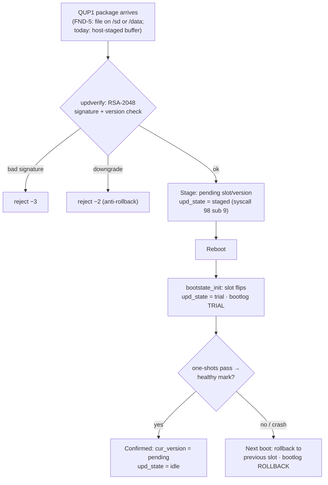

# Updates

QaonicOS updates itself with signed A/B packages. The invariant
is absolute: **an image with a bad signature is never staged**,
and a staged update that fails to prove itself at the next boot
reverts itself. Verification and staging are one atomic kernel
operation — no delivery route can bypass the check.

> **Key facts**
>
> - **Package format QUP1:** `"QUP1" | version u32 LE | length u32 LE | signature 256 B | payload`. The signed bytes are the 12 header bytes ‖ payload.
> - **Signature:** RSA-2048 PKCS#1 v1.5 + SHA-256, verified by the self-contained `updverify.c`.
> - **Rejection codes:** **−3** bad signature, **−2** downgrade (anti-rollback).
> - **QEMU package cap:** 8 KB (raising it is a flash-layout question for the hardware phase).
> - **The gap:** today a package reaches the kernel as a host-staged buffer or an embedded test image. A real file-based delivery path is **FND-5**.

## The A/B state machine

Bootstate carries the update fields (`cur_version`, `active_slot`,
`upd_state`, `pending_*`). The flow:

- **Trial boot:** the staged slot boots once, unconfirmed. It
  confirms itself only by earning the healthy mark (the one-shot
  battery passes — see [Boot & Resilience](boot-resilience.md)).
- **Rollback:** an unconfirmed trial reverts at the *next*
  `bootstate_init`, automatically.
- **Sabotage flag** (bootstate flags bit1): suppresses exactly one
  healthy mark — the test hook that proves rollback works
  (UPDATE-VERIFY battery: PASS; the signed-package one-shot
  UUPDSIG: PASS).
- **Signing tool:** `scripts/sign-update.py` (openssl). Package
  images are assembled by `scripts/build-update-img.sh`.

!!! warning "Dev key"
    `scripts/update-img/dev-key.pem` is committed **deliberately
    as a test key** — packages signed with it prove the pipeline,
    not provenance. A release key must never live on a build
    machine; key management for releases is a hardware-phase
    decision.

## FND-5: the delivery path (queued)

Goal: a real package file produced by `sign-update.py` enters the
pipeline end to end, board-less.

- Shell builtin **`update stagepkg <path>`** reads the file from
  `/sd` (FAT32) or `/data` (littlefs — persistent once FND-4
  lands) in chunks into the kernel package buffer, then calls the
  existing verify+stage path (syscall 98 sub 9) unchanged.
- The compile-time embedded package in the `uupdsig` one-shot
  stays as a unit test; `stagepkg` is the product path.
- Verification extends UPDATE-VERIFY with the real file, plus
  negative tests: tampered package → −3 and no stage; older
  version → −2.
- Non-goals: network delivery of updates (that rides the C6 link /
  web UI later) and raising the 8 KB cap.

Later delivery channels the architecture anticipates: the USB
device gadget (SOC-3) as a wired recovery/update channel, and the
web UI once the HTTP placement decision (D-ARCH-1) is executed —
none of them changes the verify-then-stage invariant.

Sources:
[`docs/rencana-update/PLAN-B4.md`](../docs/rencana-update/PLAN-B4.md),
[`docs/rencana-hardening/PLAN-B5.md`](../docs/rencana-hardening/PLAN-B5.md),
[`docs/rencana-fondasi-tanpa-board/PLAN.md`](../docs/rencana-fondasi-tanpa-board/PLAN.md) (§FND-5),
[`docs/ARSITEKTUR-SISTEM.md`](../docs/ARSITEKTUR-SISTEM.md) (§5.4),
[`docs/ARSITEKTUR.md`](../docs/ARSITEKTUR.md) (§4.5, the KEEP verdict).
